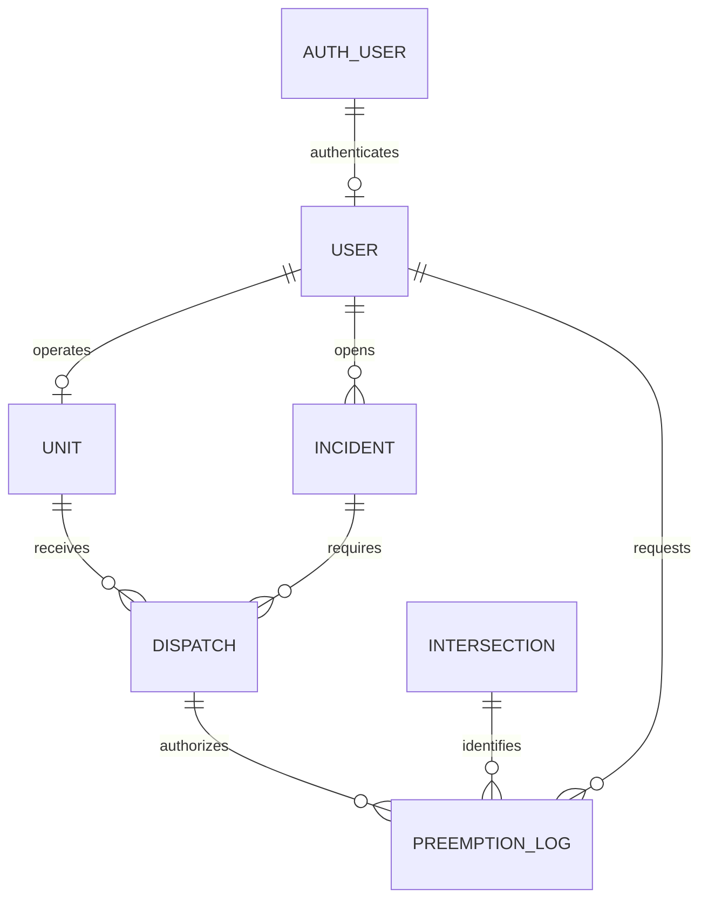

# ClearPath dispatch and security

Milestone 5 adds authenticated dispatch endpoints to FastAPI. PostgreSQL holds incidents, assignments, arrivals and priority requests. Redis on the demo laptop holds the most recent position sample and replay nonces for 60 seconds. The existing simulator still runs in memory. Its public presenter code is for the shared demonstration.

## Configure the demo laptop

1. The [versioned migration](../supabase/migrations/20261124154000_clearpath_dispatch.sql) was applied manually in the [Hackathon-supa project](https://supabase.com/dashboard/project/uodbkiyevjwgmjnofcpj) on 24 November 2026. GitHub production auto-deploy is off. Before adopting CLI-managed migrations, [record version `20261124154000` as applied](https://supabase.com/docs/guides/deployment/database-migrations#step-3-if-the-migration-history-table-is-wrong).
2. Login is enabled for `clearpath_app` on Hackathon-supa. The password is in the private file below. The Free session pooler is `aws-1-ap-northeast-1.pooler.supabase.com:5432`, database `postgres`, username `clearpath_app.uodbkiyevjwgmjnofcpj`. Use `sslmode=verify-full` and the certificate downloaded from [the project’s database settings](https://supabase.com/dashboard/project/uodbkiyevjwgmjnofcpj/database/settings). The demo laptop copy is at `C:\Temp\clearpath-supabase-ca.crt`. [Supabase connection guide](https://supabase.com/docs/guides/database/connecting-to-postgres)
3. Start Redis on the demo laptop and bind it to loopback. Set these variables privately in the shell that starts FastAPI. The Supabase publishable key can be found in **Settings → API Keys**.

| Variable | Value |
| --- | --- |
| `CLEARPATH_DATABASE_URL` | A PostgreSQL connection string for the restricted login with `sslmode=verify-full` and `sslrootcert` pointing to the downloaded certificate |
| `CLEARPATH_REDIS_URL` | `redis://127.0.0.1:6379/0` for the local Redis instance |
| `CLEARPATH_SUPABASE_URL` | `https://uodbkiyevjwgmjnofcpj.supabase.co` |
| `CLEARPATH_SUPABASE_PUBLISHABLE_KEY` | The project’s publishable key |

4. The project has three designated demo accounts, one per role. Their sign-in details are in the private local file described below. To enroll another approved account, add its Auth UUID to `clearpath.users` and add a `clearpath.units` row for a rescue account. Use Supabase-issued **access tokens** in the FastAPI API docs.
5. Start FastAPI with the [local commands](../user.md#run-locally-on-windows). Omitting all four dispatch variables leaves the public and local simulators usable without accounts. With dispatch configured, open the [local API docs](http://127.0.0.1:8000/docs) and authorize each role separately.

### Start with the private local file

After the partner guide's dependency setup, run these commands from the repository root in PowerShell. They load the server settings from the Git-ignored `.env.dispatch.local` file and start a separate dispatch rehearsal on port 8003. The demo passwords remain in the file for the tester.

```powershell
Get-Content -LiteralPath .env.dispatch.local | ForEach-Object {
    $name, $value = $_ -split '=', 2
    if ($name -in @('CLEARPATH_DATABASE_URL', 'CLEARPATH_REDIS_URL', 'CLEARPATH_SUPABASE_URL', 'CLEARPATH_SUPABASE_PUBLISHABLE_KEY')) {
        [Environment]::SetEnvironmentVariable($name, $value, 'Process')
    }
}
$env:CLEARPATH_GRAPH_PATH = (Resolve-Path 'deploy/manhattan.graphml.gz').Path
.\.venv\Scripts\python.exe -m uvicorn backend.app:app --host 127.0.0.1 --port 8003
```

The emulator can open these API docs at `http://10.0.2.2:8003/docs`. For the protected calls, use the access token from a demo account's [Supabase password sign-in](https://supabase.com/docs/reference/javascript/auth-signinwithpassword) in **Authorize**. Keep the service bound to loopback for this rehearsal.

From the repository root, run the following to sign in for a rehearsal. Change `$role` to `RESCUE` or `CITIZEN` to test that role. The last command copies the short-lived access token so you can paste it into Swagger **Authorize** or the [local report review](http://127.0.0.1:8003/dispatch/reports) form.

```powershell
$settings = @{}
Get-Content -LiteralPath .env.dispatch.local | ForEach-Object {
    $name, $value = $_ -split '=', 2
    $settings[$name] = $value
}
$role = 'DISPATCHER'
$body = @{
    email = $settings["CLEARPATH_DEMO_${role}_EMAIL"]
    password = $settings["CLEARPATH_DEMO_${role}_PASSWORD"]
} | ConvertTo-Json -Compress
$auth = Invoke-RestMethod -Method Post `
    -Uri "$($settings.CLEARPATH_SUPABASE_URL)/auth/v1/token?grant_type=password" `
    -Headers @{ apikey = $settings.CLEARPATH_SUPABASE_PUBLISHABLE_KEY } `
    -ContentType 'application/json' -Body $body
$auth.access_token | Set-Clipboard
```

## Rehearse dispatch and authorization

1. Dispatcher opens a simulated incident, checks available units on `GET /dispatch/board`, and posts an assignment. Repeat the same request ID and verify it returns the same record. Try assigning the same unit to a second incident while the first assignment is active and expect `409`.
2. Rescue can see its assignment, request priority at a known simulated signal, and mark arrival. The request is recorded in PostgreSQL. The signal simulator still computes and displays its existing synthetic green wave. The recorded request does not override a signal or assert that a green phase occurred.
3. Citizen receives `403` for a priority request. Submit a timestamped Manhattan position to `/dispatch/position`, then repeat it. The original is accepted and the repeat receives `409`. Verify the temporary Redis key expires after 60 seconds. These coordinates are not used by the milestone 4 Android alerts.
4. After arrival, the dispatcher closes the incident. The unit is available again. A new priority request for the completed assignment is denied.

Android and the public simulator still use the synthetic demo workflow. Signed-in dispatcher and rescue actions are available through the FastAPI API.

## Schema



These queries run as an operator with read access to the private schema. They describe observed dispatch records and do not measure the simulated effect of priority.

```sql
select i.incident_type, avg(d.arrived_at - d.dispatched_at) as mean_arrival
from clearpath.dispatches d join clearpath.incidents i using (incident_id)
where d.arrived_at is not null group by i.incident_type;

select d.incident_id, count(distinct p.osm_node_id) as intersections_requested
from clearpath.preemption_log p join clearpath.dispatches d using (dispatch_id)
group by d.incident_id;

select u.unit_type, count(*) as completed_dispatches
from clearpath.dispatches d join clearpath.units u using (unit_id)
where d.arrived_at is not null group by u.unit_type;
```

## Threat checks

| Threat | Implemented behavior | Verification |
| --- | --- | --- |
| Rescue impersonation | Supabase Auth verifies the access token. The backend reads the role from PostgreSQL. The SQL priority function also requires an open incident and an active assignment for the caller. | The integration check rejects an invalid token, a citizen priority request, and a priority request after arrival. |
| Position replay or impossible movement | A two-second time window, a per-user nonce and monotonic timestamps prevent repeats. Redis atomically checks the previous sample, approximate speed and nonce. FastAPI verifies the point is near the Manhattan graph. | The check submits a stale message, repeats a nonce and submits a jump. |
| Double assignment | A PostgreSQL transaction and a unique partial index allow one active assignment per unit. | Two concurrent assignments result in one success and one conflict. |
| Injection and unauthorized SQL writes | The private schema uses row-level security and parameterized function calls. The runtime account can read role columns and invoke a specific set of functions. | The check attempts a role change using the runtime account and verifies it is denied. |
| Location leakage | Redis keeps only the latest accepted sample and short-lived nonces. The authenticated API does not expose a position read endpoint. The citizen WebSocket sends only synthetic alert state. | Verify Redis TTL and the existing mobile feed check. |
| Transport and connection load | The Supabase DB connection requires verified TLS. Render uses HTTPS and WSS and caps public mobile sockets per process. | Check the deployed route and both WSS roles. Per-user connection limits and a real network latency rehearsal remain future work. |

The [dispatch CI job](../.github/workflows/dispatch.yml) uses disposable PostgreSQL and Redis services with a stubbed Auth response. Hosted Auth and database checks require configured demo credentials.
