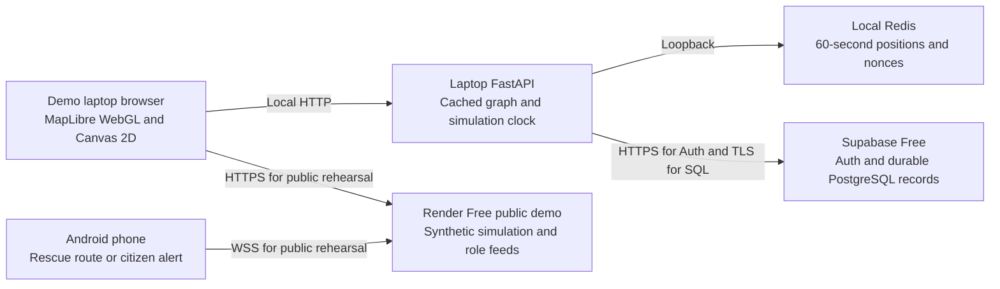
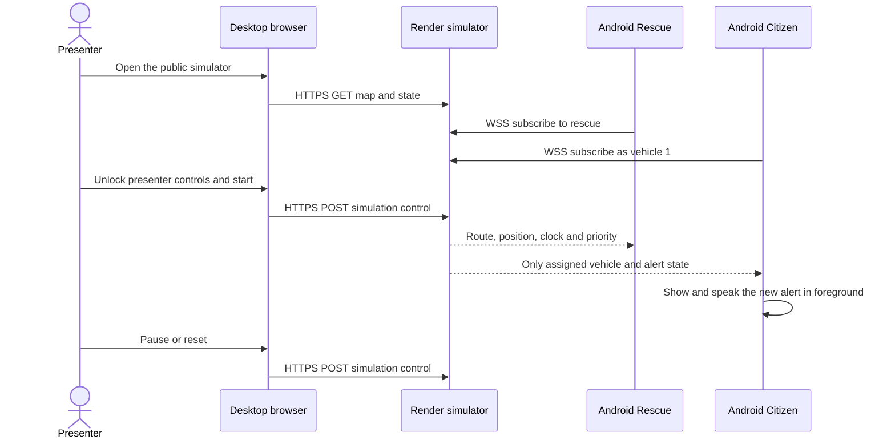

# ClearPath performance report and demo rehearsal

Measured on Lenovo on 24 November 2026 using the bundled Manhattan graph. The graph has 4,671 nodes and 9,962 directed edges. The laptop has an Intel Core Ultra 7 255H, 16 logical processors, 15.5 GiB of total RAM as reported by Windows, and Intel Arc graphics. [Raw measurements](rehearsal-measurements.json)

## What we measured

| Check | Target or reference | Observed on Lenovo | Measurement scope |
| --- | --- | --- | --- |
| A* route | Same cost as Dijkstra | 100 of 100 matched, mean 6.69 ms, p95 17.08 ms | In-process routing with cached graph, no network. |
| Single-road closure | Under 1 s | Mean 15.29 ms, p95 39.84 ms, max 56.46 ms | One physical segment removed in each of the 100 sampled routes. All had an alternate route. |
| Browser animation | 60 FPS with 500 civilian vehicles | 60.0 FPS, p95 frame interval 16.8 ms | Foreground Chromium, 1440 × 900, one 10-second window at 1× speed. At 240 vehicles the same setup also measured 60.0 FPS. |
| Rescue stream | 5 updates per second while running | 4.85 updates per second, p95 interval 217.13 ms | Laptop loopback WebSocket with 500 simulated vehicles and 30 intervals. |
| Route-based geofence | Under 50 ms for 10,000 simulated civilians | Mean 0.93 ms, p95 1.45 ms | Forty runs of the in-memory corridor check over a synthetic snapshot, with seven matching vehicles. Full traffic, WebSocket and database load were outside this measurement. |
| Priority change during pause | Diagnostic | 1,014 ms to the citizen feed | Laptop sends the desktop-style REST change and reads the citizen WebSocket. The paused feed wakes about once a second. |
| Hosted connection | Verified HTTPS and WSS | Public HTTPS health p95 167.00 ms, WSS ping p95 71.74 ms | Ten warmed requests and ten ping-pong round trips from the laptop. Both Rescue and Citizen received data. The sampled Render release was `f96b6b1`. |

The under-300-ms target in the specification is for a phone-originated location reaching the desktop display. These measurements cover transport and selected application paths, so the phone-to-screen target is still unverified. Wi-Fi versus cellular also needs a controlled comparison on the presentation devices.

## Before and after

| Change | Before | After | Explanation |
| --- | ---: | ---: | --- |
| Gzip on the same desktop snapshot at 500 vehicles | 49,978 bytes | 12,842 bytes | About 74% less payload. This compares identical JSON at compression level 3, excluding protocol overhead. |
| Separate role feeds | 49,978-byte full JSON snapshot | 3,971-byte Rescue, 91-byte Citizen | The feeds carry only the role's data. Citizen receives its vehicle assignment and alert state. |

In the paired Bellevue Hospital to Times Square run, normal signals took **394.8 simulated seconds** and the green wave took **288.4 seconds**, a **26.95% reduction** with the same seeded traffic. These are model outputs for that run. [Priority test](../backend/check_priority.py)

## Hardware decisions

1. **Laptop graphics.** MapLibre draws the base map with WebGL. A Canvas 2D overlay interpolates and draws vehicles. FastAPI updates simulation state independently of the browser's frame cadence, so about five state updates per second can drive a 60 FPS animation.
2. **CPU and scheduling.** The route API uses a synchronous handler that FastAPI offloads to its thread pool. In a 20-route experiment, the worst delay of a 10-ms heartbeat was 110.66 ms when routing ran inline, 27.99 ms with thread offload, and 11.09 ms with a warm separate process. The warm-process batch took 151.42 ms versus 149.49 ms for threads. The experiment measures scheduling behavior after the graph is loaded, and the running API still uses threads.
3. **Memory and storage.** FastAPI loads the OSM graph into RAM once per process. Redis keeps accepted position samples and nonces for 60 seconds. PostgreSQL stores the assignment and priority audit. Keeping short-lived coordinates in Redis avoids a durable database write on every position update.
4. **Phone workload.** The Android client renders a compact route or an alert. It receives role-specific messages over WSS and keeps the citizen speech alert in the foreground. The laptop remains responsible for the simulation clock and the desktop map.



The Render and laptop simulators are separate instances. Open both Android roles and the desktop view against the same base URL when showing a shared scenario.

## Rehearsal sequence



The authenticated dispatch rehearsal runs separately on the laptop. A dispatcher signs in, reviews a local model draft, opens an incident and assigns a rescue unit. An assigned rescue account records a priority request in Supabase. A citizen priority request receives `403`. The laptop accepts a fresh position and rejects a repeated nonce. The dispatcher closes the incident after the rescue account marks arrival. [Dispatch setup](dispatch.md)

| Signed-in check | Observed |
| --- | --- |
| Fresh citizen position and duplicate sent together | One request returned `200` and the duplicate returned `409` for the repeated nonce. |
| Assignment and audit | Supabase stored the assignment and one matching audit row. The arrival was recorded and the incident closed. |
| Authenticated request timing | Role checks took 3.14–3.79 seconds. Opening, assigning, and closing the incident took 6.41–6.46 seconds end to end in this rehearsal. |

Before the fix, a fresh position could return `409` because the age check ran after the cloud identity and role lookups. The server now captures its own receive time before those lookups. The two-second freshness check, account authorization and Redis replay protection still apply. The request took about 3.76 seconds to complete in this run. [Dispatch trace](dispatch-rehearsal-trace.json)

## Reproduce before presenting

1. Start Redis, the local report model and the signed-in FastAPI instance using the [dispatch guide](dispatch.md#start-with-the-private-local-file). Verify the [local report page](http://127.0.0.1:8003/dispatch/reports). Run the authenticated lifecycle from the repository root.

   ```powershell
   .\.venv\Scripts\python.exe -m backend.rehearse_dispatch --graph deploy/manhattan.graphml.gz
   ```

2. In a separate PowerShell terminal, start a disposable simulator on port 8014. Run the measure script from another terminal. It resets the disposable local scenario as it measures. The public probe only reads data.

   ```powershell
   $env:CLEARPATH_GRAPH_PATH = (Resolve-Path 'deploy/manhattan.graphml.gz').Path
   .\.venv\Scripts\python.exe -m uvicorn backend.app:app --host 127.0.0.1 --port 8014
   ```

   ```powershell
   $env:CLEARPATH_GRAPH_PATH = (Resolve-Path 'deploy/manhattan.graphml.gz').Path
   .\.venv\Scripts\python.exe -m backend.measure_demo --public https://clearpath-hackatonintel.onrender.com
   ```

3. Open the [local frame meter](http://127.0.0.1:8014/simulator?measureFrames=1) in a foreground desktop-sized window. Set 1× playback and 500 civilian vehicles, then wait ten seconds. Read the interval and FPS from the top bar. A background tab can be throttled and is unsuitable for this check.
4. On the presentation network, open the public simulator and connect Rescue and Citizen on two phones or a phone and emulator. Set Citizen to Vehicle 1. In the paused default scenario, toggle green-wave priority off and wait for the alert to clear, then turn it on and wait for the visual and spoken alert. Start and pause playback and confirm that the route and clock agree across displays. [Android instructions](../mobile/README.md)

## Remaining physical checks

Rehearse on the presentation phones with media volume on, record the citizen audio, and measure a phone-originated location reaching the desktop. The Android public demo uses synthetic positions and presenter access. Its live feed is distinct from the authenticated audit workflow, which stores priority requests without changing the simulated signals.
