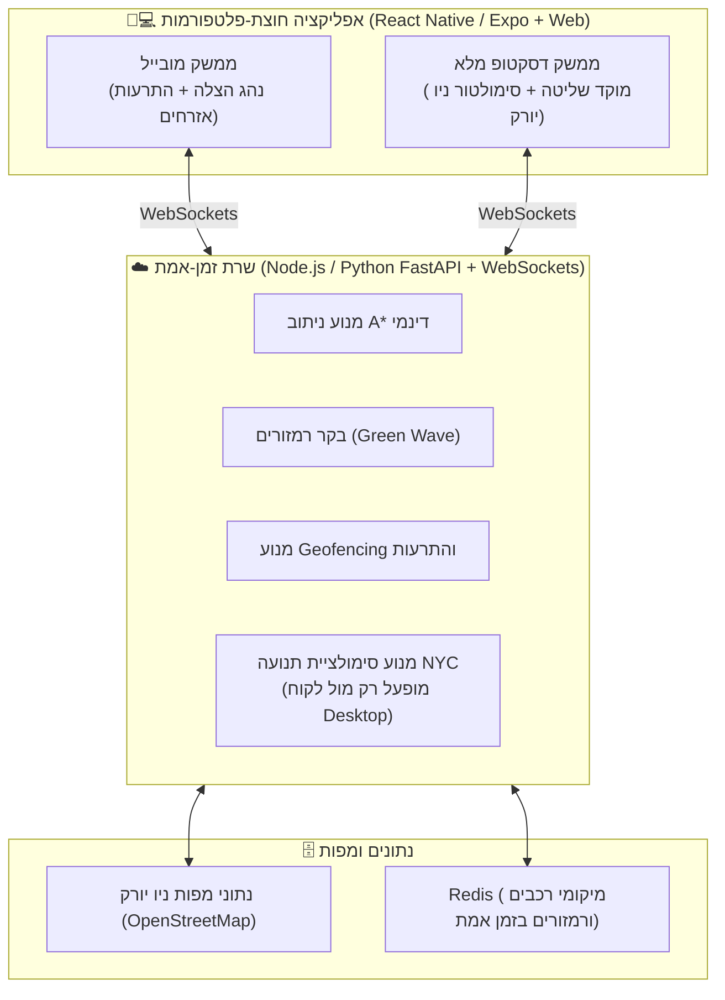

# מסמך אפיון מערכת (System Design & PRD)

**שם הפרויקט:** ClearPath AI — מערכת חכמה לפינוי צירים ותעדוף כוחות הצלה בזמן אמת

**פלטפורמות יעד:** אפליקציה חוצת-פלטפורמות (מחשב + טלפון נייד) + מודול סימולציה תלת-ממדית/דו-ממדית של ניו יורק (למחשב בלבד)

## 1. תקציר מנהלים ומטרת הפרויקט

**ClearPath AI** היא מערכת שליטה, בקרה וניתוב בזמן אמת המיועדת לקצר משמעותית את זמני ההגעה של רכבי חירום והצלה (אמבולנסים,כבאיות, ניידות משטרה) לזירות אירוע. המערכת משלבת ניתוח עומסי תנועה, שליטה דינמית ברמזורים ("גל ירוק" חכם), זיהוי תאונות וחסמים בכביש, והתרעה לנהגים אזרחיים לפינוי הנתיב.

המערכת כוללת:

1. **אפליקציה מבצעית וציבורית (מחשב + מובייל):** ממשק ניהול למוקד/נהג רכב ההצלה וממשק התרעה לנהגים סמוכים.
2. **סביבת סימולציה עירונית — ניו יורק (מחשב בלבד):** מנוע הדמיה אינטראקטיבי המדמה רשת כבישים אמיתית של מנהטן (ניו יורק), תנועת כלי רכב, תאונות פתע, רמזורים ורכב הצלה המנווט מנקודת מוצא ליעד תחת תנאים משתנים.

## 2. קהלי יעד וממשקי משתמש (Cross-Platform)

| **ממשק / מודול** | **פלטפורמה נתמכת** | **קהל יעד** | **תפקיד מרכזי** |
| ---: | ---: | ---: | ---: |
| **ממשק נהג הצלה (Emergency Unit App)** | טלפון נייד + מחשב | נהגי אמבולנס / כיבוי / משטרה | קבלת קריאה, ניווט דינמי עוקף פקקים ותאונות, הפעלת עדיפות רמזורים אוטומטית. |
| **ממשק נהג אזרחי (Citizen Alert App)** | טלפון נייד | נהגים פרטיים בקרבת הציר | קבלת התרעה קולית וויזואלית בזמן אמת: *"רכב הצלה מתקרב מאחוריך – פנה לנתיב הימני"*. |
| **מרכז שליטה ובקרה (Command Center)** | מחשב (Web/Desktop) | מוקדני חירום ובקרי תנועה | תמונת מצב עירונית חיה, ניהול אירועים, פתיחת נתיבי חירום ומעקב אחר כלל הרכבים. |
| **סימולטור עירוני — ניו יורק (NYC Sim)** | **מחשב בלבד** | מפתחים, חוקרים והדגמות | הדמיה ויזואלית מלאה של רחובות מנהטן, הזרקת תקלות/תאונות, ובחינת ביצועי האלגוריתם. |

## 3. דרישות פונקציונליות (Functional Requirements)

### 3.1 מנוע ניתוב חכם ועקיפת חסמים (Dynamic Routing Engine)

- **חישוב מסלול מבוסס-עלות זמן אמת:** שימוש באלגוריתם `A*` (A-Star) או Dijkstra דינמי המשקלל מרחק, מהירות נסיעה נוכחית בכל מקטע, מספר נתיבים, עומסי תנועה ודיווחי תאונות.
- **חישוב מחדש (Re-routing) מיידי:** ברגע שמדווחת תאונה או חסימה על הציר הנבחר, המערכת מחשבת מסלול חלופי תוך פחות משנייה ומעדכנת את נהג ההצלה ואת מערכת הרמזורים.

### 3.2 בקרת רמזורים חכמה ("גל ירוק" — Traffic Signal Preemption)

- **חיזוי הגעה לצומת (ETA per Intersection):** המערכת מחשבת את זמן ההגעה המדויק של רכב ההצלה לכל צומת לאורך המסלול.
- **תעדוף הדרגתי:** כ-15–20 שניות לפני הגעת רכב ההצלה לצומת, הרמזור בכיוון הנסיעה עובר לירוק (ושאר הכיוונים לאדום בבטחה), כדי לאפשר לרכבים התקועים בצומת להספיק להתפנות.
- **איפוס אוטומטי:** מיד לאחר חציית הצומת (מאומת לפי GPS), הרמזור חוזר למחזור הפעולה הרגיל שלו.

### 3.3 פינוי נתיב והתרעה לנהגים סמוכים (Geofencing Alerts)

- יצירת "מסדרון וירטואלי" (Geofence) דינמי הנע כ-300–500 מטרים לפני רכב ההצלה.
- כל מכשיר מובייל של נהג הנמצא בתוך המסדרון מקבל התרעה ממוקדת עם כיוון ההגעה של רכב ההצלה והנחיה לאיזה צד לסטות (למשל:*"אמבולנס בעוד 250 מטר – היצמד לימין"*), כדי למנוע מצב של "התראה מיותרת" לנהגים ברחובות מקבילים.

### 3.4 מודול סימולציה: רחובות ניו יורק (למחשב בלבד)

מודול זה יפעל אך ורק בגרסת המחשב (Desktop / Web רחב) ויחסם במובייל בשל דרישות עיבוד וגודל מסך:

- **מפת רשת אמיתית של מנהטן (NYC Grid):** טעינת נתוני רחובות אמיתיים (מ-OpenStreetMap), כולל שדרות (Avenues) ורחובות חוצים (Streets), כיווני תנועה (חד-סטרי/דו-סטרי), מספר נתיבים ומיקומי צמתים מרומזרים.
- **הדמיית תנועה (Traffic Micro-Simulation):** מאות כלי רכב אוטונומיים-מדומים הנעים על המפה, עוצרים ברמזורים אדומים, מאטים בעומסים ומפנים נתיב כאשר רכב ההצלה מתקרב.
- **סרגל שליטה והזרקת אירועים בזמן אמת (Interactive Sandbox):**
  - בחירת נקודת מוצא (למשל: בית חולים Bellevue) ויעד אירוע (למשל: Times Square).
  - כפתור **"הזרקת תאונה" (Spawn Accident):** לחיצה על כל כביש במפה חוסמת נתיב או את כל הכביש ומייצרת פקק מתפשט.
  - כפתור **"יצירת עומס תנועה":** העלאת צפיפות הרכבים באזור מסוים.
  - **מצב השוואה (A/B Benchmark):** הצגת מדד חיסכון בזמן — זמן הגעה *ללא* המערכת לעומת זמן הגעה *עם* ClearPath AI (שליטה ברמזורים + פינוי נתיבים).

## 4. ארכיטקטורה טכנולוגית (Tech Stack)

כדי לעמוד בדרישה של **הרצה אחידה על מחשב וטלפון**, לצד **מודול סימולציה כבד למחשב בלבד**, מומלצת הארכיטקטורה הבאה:

Code snippet

### בחירת טכנולוגיות מומלצת:

- **Frontend (קוד אחיד למחשב ולמובייל):** **React Native עם Expo (כולל Expo Web)** או **Flutter**.
  - זיהוי פלטפורמה (`Platform.OS === 'web'` וגודל מסך): במובייל נטענים רק מסכי הנהג וההתרעות; במחשב נפתח גם טאב **NYC Simulation**.
- **מנוע מפות וסימולציה (במחשב):** **MapLibre GL / Deck.gl** (להצגת מפת ניו יורק ורינדור חלק של מאות רכבים ורמזורים על גבי כרטיס המסך ב-60FPS).
- **Backend וזמן אמת:** **Python (FastAPI)** או **Node.js** עם תקשורת **WebSockets (Socket.io)** לעדכון מיקום רכב ההצלה ומצב הרמזורים כל 200 מילישניות.
- **נתוני רחובות ניו יורק:** ייצוא גרף הכבישים של מנהטן באמצעות ספריית **OSMnx** (Python) לפורמט JSON/GeoJSON קל ומהיר.

## 5. תסריט הדגמה מלא (End-to-End Flow)

1. **הפעלה במחשב:** המשתמש פותח את מסך הסימולציה של מנהטן (ניו יורק), מגדיר רמת תנועה גבוהה (Rush Hour) ומזריק תאונת דרכים בשדרה החמישית.
2. **הזנקת אירוע:** במוקד השליטה נפתח אירוע חירום, ורכב הצלה מוזנק ליעד.
3. **סנכרון למובייל:** במקביל, בטלפון הנייד (המחובר לאותו שרת) מופיע מסך הנהג עם המסלול המחושב העוקף את התאונה, ובטלפון שני (המדמה נהג אזרחי) קופצת התרעה קולית לפנות את הנתיב כשהאמבולנס מתקרב לרדיוס שלו.
4. **תנועה ורמזורים:** על מסך המחשב רואים בזמן אמת את הרמזורים לאורך הציר מתחלפים לירוק לפני האמבולנס, את הרכבים המדומים זזים הצידה, ואת שעון העצר מציג חיסכון של כ-35%–45% בזמן ההגעה.

## 6. שלבי פיתוח מוצעים (Milestones)

1. **שלב 1 — שרת ונתוני מפה:** הורדת גרף הכבישים והצמתים של מנהטן (OSM) ובניית מנוע ניתוב `A*` בסיסי.
2. **שלב 2 — סימולטור ניו יורק (Desktop):** תצוגת מפה אינטראקטיבית, תנועת רכבים, החלפת צבעי רמזורים ואפשרות לחסימת כבישים בלחיצת עכבר.
3. **שלב 3 — לוגיקת פינוי צירים:** מימוש אלגוריתם ה"גל הירוק" וה-Geofencing להתרעת נהגים.
4. **שלב 4 — אפליקציית מובייל מסונכרנת:** בניית ממשקי הטלפון (נהג חירום + אזרח) וחיבורם ב-WebSockets לסימולציה שרצה על המחשב.

האם תרצה שאפרט כעת את **מבנה הנתונים (Data Schema) והאלגוריתמים** של הסימולציה והרמזורים, או שנתחיל לבנות שלד קוד ראשוני למפת ניו יורק?
